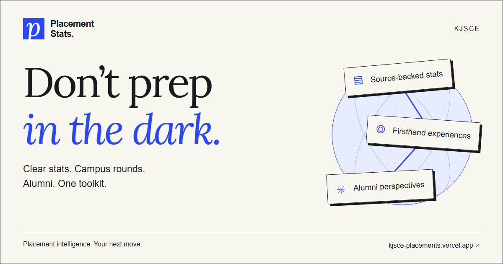
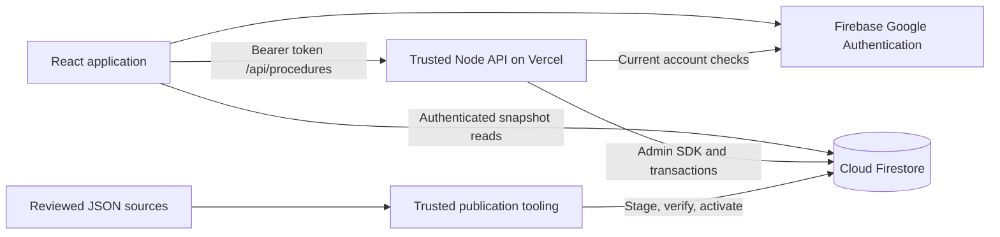

# Placement Stats KJSCE

**Source-backed placement statistics and reviewed interview experiences for KJSCE students.**

[](package.json)
[](tsconfig.json)
[](LICENSE)

Placement announcements are useful evidence, but difficult to compare across companies, branches and years. This project turns reviewed records into searchable dashboards while keeping reported counters, calculated selections and missing information distinct. Its community workspace lets students write private drafts and publish experiences through administrator review.

[Open the app](https://kjsce-placements.vercel.app) · [Get started](docs/getting-started.md) · [Architecture](docs/architecture.md) · [Documentation index](docs/README.md) · [Contribute](CONTRIBUTING.md)



*Project social preview artwork, not an application screenshot. The app URL returned HTTP 200 during this documentation pass; authenticated production workflows were not audited.*

## What is implemented

- **Placement exploration:** company and branch views, candidate search, timelines, compensation distributions, insights and source notes for visible 2025 and 2026 batches.
- **Traceable calculations:** immutable publications with SHA-256 verification and schema validation. Unknown dates, compensation and registration denominators remain unknown.
- **Reviewed experiences:** Live formatted drafts, version conflicts, submission snapshots, moderation, voting, bookmarks and private reports.
- **Personal updates:** an in-app inbox with read/archive controls and opt-in company, experience and batch follows.
- **Administrative operations:** moderation, account access, staged imports, guarded publication/rollback, identity repairs, audit history and bounded analytics.
- **Responsive interface:** theme controls, keyboard navigation, reduced-motion treatments and static fallbacks for lazy-loaded landing graphics.

The 2027 snapshot is retained and tested but hidden by current routing. New questions/replies and alumni contacts are unavailable. See [features and limits](docs/features.md).

## Architecture at a glance



Statistics reads do not invoke the API. Community mutations do: browser Firestore writes are denied except for the owner's constrained display-name profile. Local beta uses Firebase callable Functions instead of production HTTP. [Read the design](docs/architecture.md).

## Quick start: isolated local beta

Install **Node.js 22**, **npm** and **Java 21+**, then run from the repository root:

```sh
npm ci
npm ci --prefix functions
npm run dev:beta
```

Open `http://localhost:5174` and choose **Test as contributor**, **admin** or **reader**. The launcher starts Firebase emulators, seeds datasets and the recruiter catalog, and creates test accounts. Data is ephemeral; no live credentials are needed. See [setup and cloud development](docs/getting-started.md).

## Technology

| Layer | Implementation |
| --- | --- |
| Interface | React 19, TypeScript, Vite 8, CSS, hash routing |
| Graphics and writing | Three.js, Paper Design shaders, react-markdown, remark-gfm |
| Identity and persistence | Firebase Authentication, Cloud Firestore |
| Trusted services | Node.js 22, Firebase Admin SDK, Zod, Vercel HTTP handler |
| Local backend | Auth/Firestore/Functions emulators; callables in `asia-south1` |
| Verification | Node test runner through tsx, Firebase rules tests, Playwright desktop/mobile |

## Documentation

| Start here | Technical references | Maintain and operate |
| --- | --- | --- |
| [Getting started](docs/getting-started.md) | [Architecture](docs/architecture.md) | [Development](docs/development.md) |
| [Features and routes](docs/features.md) | [API reference](docs/api-reference.md) | [Deployment](docs/deployment.md) |
| [Configuration](docs/configuration.md) | [Database](docs/database.md) | [Operations](docs/operations.md) |
| [Troubleshooting](docs/troubleshooting.md) | [Authentication](docs/authentication.md) | [Security](docs/security.md) |
| [All guides and audits](docs/README.md) | [Data dictionary](docs/data-dictionary.md) | [Admin workspace](docs/admin-workspace-implementation.md) |

## Community and security

Read [CONTRIBUTING.md](CONTRIBUTING.md), the [Code of Conduct](CODE_OF_CONDUCT.md) and [security reporting policy](SECURITY.md). Useful contributions include reproducible bugs, accessibility improvements, source-backed corrections and tests. Keep student records, account details and credentials out of public reports.

## Licensing and acknowledgments

Original project code and documentation are available under the [MIT License](LICENSE). Bundled Lora fonts retain their [SIL Open Font License](public/fonts/lora/OFL.txt), and third-party libraries retain their respective licenses. Company logos, placement source material and personal records are not relicensed by the software license; their respective rights and privacy requirements still apply.

The project builds on reviewed placement announcements, the preserved [legacy dashboard](legacy/index.html), community contributions and libraries in [package.json](package.json). Extraction limitations remain in the [2025 audit](docs/2025-data-audit.md), [2027 audit](docs/2027-data-audit.md) and [migration report](docs/migration-report.md).
