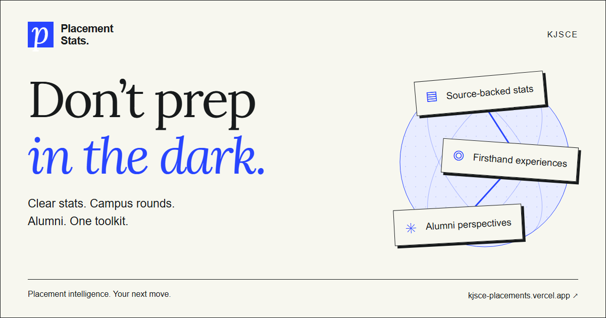
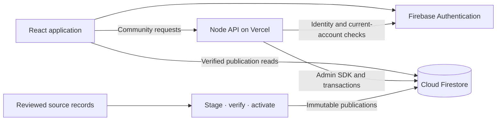

<p align="center"></p>

# Placement Stats KJSCE

**Placement intelligence, built by students for students.**

Explore KJSCE placement outcomes, learn from recruitment experiences, and give the next batch a head start. Placement Stats brings reviewed placement records and community knowledge into one place, with the sources and limits kept close to the numbers.

[**Open Placement Stats**](https://kjsce-placements.vercel.app) · [Documentation](docs/README.md) · [Contribute](CONTRIBUTING.md) · [Our story](https://kjsce-placements.vercel.app/#about)

[](package.json)
[](tsconfig.json)
[](LICENSE)



## A clearer picture of placement season

| Explore | Learn | Give back |
| --- | --- | --- |
| Compare companies, roles, compensation, branches and hiring timelines across the Classes of 2025, 2026 and 2027. | Read reviewed recruitment experiences, save useful accounts and find available alumni profile links within company records. | Write in a live formatted editor, save a private draft and submit an experience for review. Company-specific invitations bring alumni straight to the right writing page after sign-in. |

- **Evidence behind the numbers.** Source-backed records, batch-specific metric definitions and expandable methodology notes distinguish reported totals, calculated selections and missing information.
- **Knowledge from the community.** Company directories, experience filters, helpfulness votes, bookmarks and private reporting help students find and assess relevant accounts.
- **A considered writing experience.** Company context, recorded roles, optional supporting details, automatic draft saves and live formatting make contributing easier on desktop and phone.
- **Review before publication.** Administrators approve, request changes or reject submitted revisions. Version checks, audit history and contributor notifications preserve a traceable review process.
- **Designed for daily use.** Responsive layouts, paginated tables, light and dark themes, keyboard access and reduced-motion fallbacks support different devices and preferences.

The ongoing Class of 2027 is marked **Live**. Coverage advances through reviewed publications; it is not an automatic feed. See [features and data interpretation](docs/features.md) for coverage and [the data dictionary](docs/data-dictionary.md) for metric definitions.

## Run locally

Use **Node.js 22**, **npm** and **Java 21+**. From the repository root:

```sh
npm ci
npm ci --prefix functions
npm run dev:beta
```

Open **http://localhost:5174** and choose a contributor, reader or administrator test account. The local beta starts isolated Firebase emulators and seeds sample application data without live credentials. Its state is temporary.

For environment setup, ports and development against a Firebase project, see [Getting started](docs/getting-started.md).

## Architecture



Statistics load directly from immutable Firestore publications and are checked against their SHA-256 hashes. Community mutations go through the trusted API, where authentication, ownership, input validation and version checks are enforced. Local emulator testing uses callable adapters for the same services. [Architecture guide →](docs/architecture.md)

## Technology

| Area | Stack |
| --- | --- |
| Application | React 19, TypeScript, Vite 8, CSS, hash-based routing |
| Writing and reading | Tiptap / ProseMirror, Markdown serialization, react-markdown, remark-gfm |
| Visuals | Three.js, Paper Design shaders, accessible static fallbacks |
| Identity and data | Firebase Authentication, Cloud Firestore |
| Trusted backend | Node.js 22, Firebase Admin SDK, Zod, Vercel |
| Verification | Node test runner through tsx, Firebase emulators/rules tests, Playwright desktop and mobile |

## Documentation

| Guide | What you’ll find |
| --- | --- |
| [Getting started](docs/getting-started.md) · [Development](docs/development.md) | Local setup, repository structure, scripts and testing |
| [Features and routes](docs/features.md) | Statistics, writing, invitations, notifications and navigation |
| [Architecture](docs/architecture.md) · [API reference](docs/api-reference.md) | Component interactions, lifecycle, request contracts and errors |
| [Database](docs/database.md) · [Data dictionary](docs/data-dictionary.md) | Storage, immutable publications, source coverage and calculations |
| [Authentication](docs/authentication.md) · [Security](docs/security.md) | Identity, permissions, trust boundaries and security controls |
| [Configuration](docs/configuration.md) · [Deployment](docs/deployment.md) | Environment settings, hosting and release ordering |
| [Admin workspace](docs/admin-workspace-implementation.md) · [Operations](docs/operations.md) | Review workflows, account management, publication and recovery |
| [Troubleshooting](docs/troubleshooting.md) · [All documentation](docs/README.md) | Diagnostics, source audits and engineering records |

## Contributing

Bug reports, accessibility improvements, clearer documentation and source-backed corrections are welcome. Read [AGENTS.md](AGENTS.md) and [CONTRIBUTING.md](CONTRIBUTING.md) before making changes; every pull request must include the required AGENTS.md compliance statement. Community participation follows the [Code of Conduct](CODE_OF_CONDUCT.md).

For vulnerabilities, follow [SECURITY.md](SECURITY.md). Keep credentials and personal records out of public issues. Operational and policy decisions are tracked in the [maintainer guide](docs/maintainer-decisions.md).

## License and acknowledgments

Original project code and documentation are available under the [MIT License](LICENSE). Third-party logos, placement source material, personal records and user contributions retain their separate rights; the code license does not grant permission to reuse them. Bundled Lora fonts use the [SIL Open Font License](public/fonts/lora/OFL.txt).

Built by **Ritesh and Saksham**, with thanks to the students and alumni who shared their experiences, supported the [original dashboard](https://placementsatkjsce-26.vercel.app/), and helped this project grow. Placement Stats is an independent student project. Read [our story, sources and privacy notes](https://kjsce-placements.vercel.app/#about).
