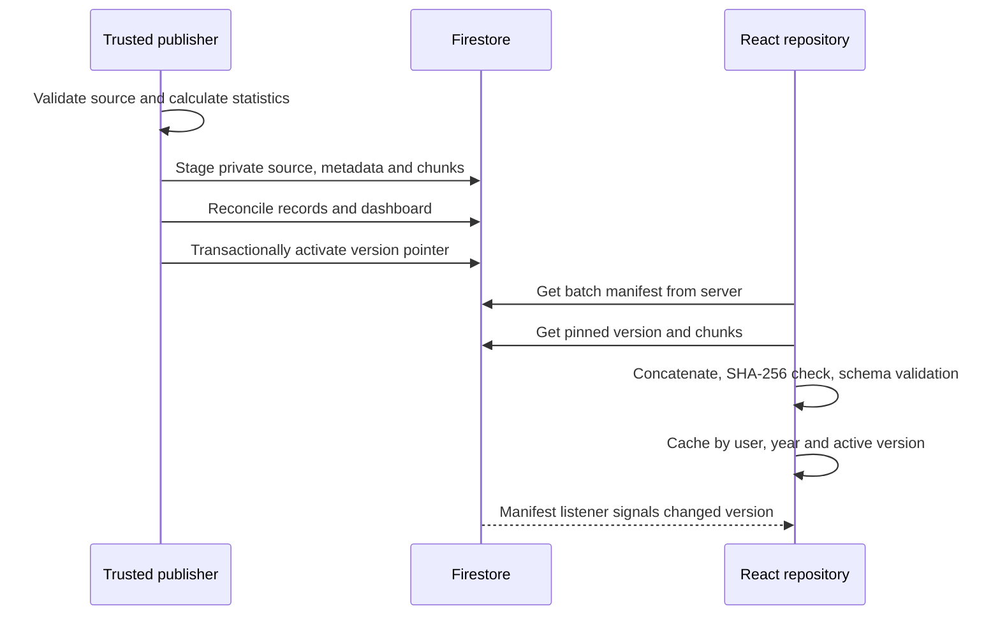
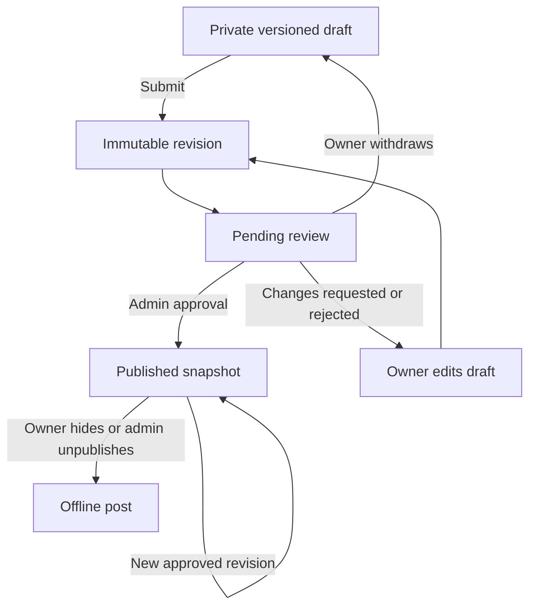

# Architecture

[Documentation index](README.md) · [Database](database.md) · [API](api-reference.md)

## Components

This is a Vite React application with a trusted Firebase-backed service layer, not an Express server. `src/app/main.tsx` mounts the app; `src/app/App.tsx` composes theme, authentication, notification and recovery providers. Hash routing in `src/app/routing.ts` avoids individual server routes for dashboard pages.

| Component | Responsibility | Source |
| --- | --- | --- |
| Public landing | Curated examples, Google entry, lazy graphics/fallbacks | `src/landing/` |
| Portal | Home, account, batch navigation and guards | `src/app/` |
| Dashboard | Snapshot loading, company/branch/candidate/timeline views | `src/dashboard/` |
| Experiences | Editor, reader, directory and moderation | `src/procedures/` |
| Community/inbox | Paged reads, bookmarks, contributions, notifications | `src/community/`, `src/notifications/` |
| Administration | Users, imports, quality, audit and analytics | `src/admin/`, `functions/src/admin*.ts` |
| Domain contracts | Validation, statistics, publication and identities | `shared/` |
| Backend adapters | HTTP and callable wrappers | `api/procedures.mjs`, `functions/src/http.ts`, `functions/src/index.ts` |
| Maintenance | Source builders, seeding, rules, roles and verification | `scripts/` |

`functions/` contains shared backend code as well as Cloud Functions wrappers. Vercel imports its compiled HTTP module; Cloud Functions is not required for production. Emulator mode selects callables. Both transports delegate to shared services. The callable wrapper sets `asia-south1` and `maxInstances: 10`; these settings do not configure Vercel.

## Publication and read flow

`scripts/publication.ts` calculates statistics, serializes the dashboard and splits it into UTF-8-safe chunks of at most 100,000 bytes by default. The content-derived version includes source hash, payload hash, schema version and batch configuration. Staging creates missing documents and rejects different existing content. Activation verifies the publication and checks the expected old version.

`src/dashboard/repository.ts` checks verified Google identity before reading, pins one version per load, validates the year, bounds chunk count to 1–128, verifies SHA-256 and parses the dashboard schema. Hashes detect corruption; source truth still depends on review and trusted access.

Concurrent requests share a user/year promise. Up to six dashboard entries remain in memory. A server manifest check precedes reuse; a listener watches the small pointer instead of repeatedly downloading chunks. No explicit persistent offline dataset cache is configured. Statistics reads stay independent of API availability and avoid repeated browser aggregate computation.

## Experience lifecycle

Draft saves compare `expectedVersion` transactionally. Submission freezes a revision and writes status, moderation event and private notification atomically. Approval copies that revision into `procedurePosts`; later draft edits do not silently change the public snapshot. Rejection/change requests require feedback. Votes update per-user state and aggregate counts in one transaction; self-voting is denied.

Author deletion removes public access and leaves a tombstone to stop stale autosave from recreating writing. Revision/post/discussion/report cleanup follows outside the transaction and can be retried. This is not a complete account-erasure or backup-purge mechanism.

## Refresh, jobs and failures

Community reads coalesce pending requests by user/action/payload; preserved page windows are bounded in memory. `useBackgroundSync` runs while visible and online, reacts to focus/connectivity/data-change events, prevents overlap and backs off after failure up to ten minutes. Review queues require explicit refresh to avoid silently replacing a case while an administrator acts.

Admin jobs are client-driven bounded steps with checkpoints and leases, not autonomous workers. Imports stage privately before a separate publish action; repairs use reviewed aliases, backups and guarded recovery. See [admin operations](admin-workspace-implementation.md).

Session/load timeouts, retry feedback and a React recovery boundary handle browser failures. The HTTP adapter maps domain errors to JSON statuses and suppresses unknown exception details. Sampled private failure telemetry does not provide infrastructure monitoring.

These decisions follow the implementation. Broader product rationale and production status need maintainer confirmation. The legacy HTML and dated design reports are historical evidence, not additional running services. See [metric policies](data-dictionary.md).
