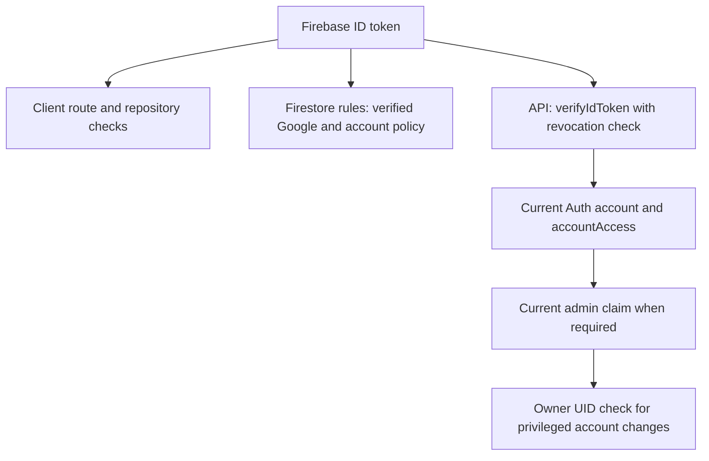

# Authentication and authorization

[Documentation index](README.md) · [API](api-reference.md) · [Security](security.md)

## Google-only application access

`src/lib/auth.tsx` uses Firebase Google popup sign-in with account selection. `onIdTokenChanged` resolves sessions; a qualified session has provider `google.com` and `email_verified == true`. The application has no email/password registration UI. Historical password-related error translations do not imply a supported password login flow.

Signed-out visitors see the public landing. Protected deep links preserve the hash destination until authentication succeeds. Signed-in landing/login visitors go Home. Logout calls Firebase sign-out and navigates to `#landing`; protected components unmount. Firebase SDK session persistence handles reloads; no custom cookie session or application password store is implemented.

The landing uses curated committed examples and does not require reading private placement snapshots. Its graphics and branding are not an authorization boundary.

## Independent enforcement layers

| Capability | Required authority |
| --- | --- |
| Public landing | None |
| Published statistics/experiences | Verified Google session permitted by account policy |
| Drafts, bookmarks and inbox | Same identity plus resource ownership |
| Review/unpublish/admin workspace | Admin claim and current backend account checks |
| Assign roles in app or alter another administrator | Existing admin plus server `ADMIN_OWNER_UIDS` membership |
| Trusted CLI maintenance | Separate Admin SDK/IAM credentials; does not use browser authorization |

Contributor and moderator claims can be assigned by the legacy CLI but do not substitute for the `admin` claim in moderation. Ordinary verified Google users can contribute without a contributor claim. `ADMIN_OWNER_UIDS` grants no admin claim and does not bootstrap an owner.

## Revocation and account management

The HTTP API verifies token revocation, loads the current Auth account and reads `accountAccess/{uid}`. Suspension denies API actions and rule-protected reads. `revokedBefore` rejects sessions whose token `auth_time` is older than the policy. Current admin status is rechecked on privileged server calls rather than trusting only the UI's token claim.

In-app account changes require a reason, request ID and exact access version. Self-access changes are blocked. Only owners can modify admins; final-active-admin removal is blocked after a bounded inventory check. Access policy is updated before risky Auth writes so partial failures remain blocked and audited. Restoration does not revive old sessions; sign in again.

Direct Firestore admin reads rely on token claims and account policy; the API additionally checks current Auth records. Do not treat all credential paths as identical or assume token/UI refresh instantly changes every surface.

## Bootstrap and local testing

For an authorized live project, sign in with Google once, then use the trusted role command described in [operations](operations.md). Sign out/in afterward. Configure owner UIDs separately in server hosting. The trusted CLI is more powerful than in-app safeguards and must be operated by an authorized maintainer.

Local beta imports three emulator accounts and signs in through development-only mock Google credentials. It does not exercise real popup OAuth, authorized domains or production IAM. Verify real Google sign-in manually after deployment. Do not delete an existing UID to resolve an account-provider conflict; review an authenticated account-linking migration instead.
