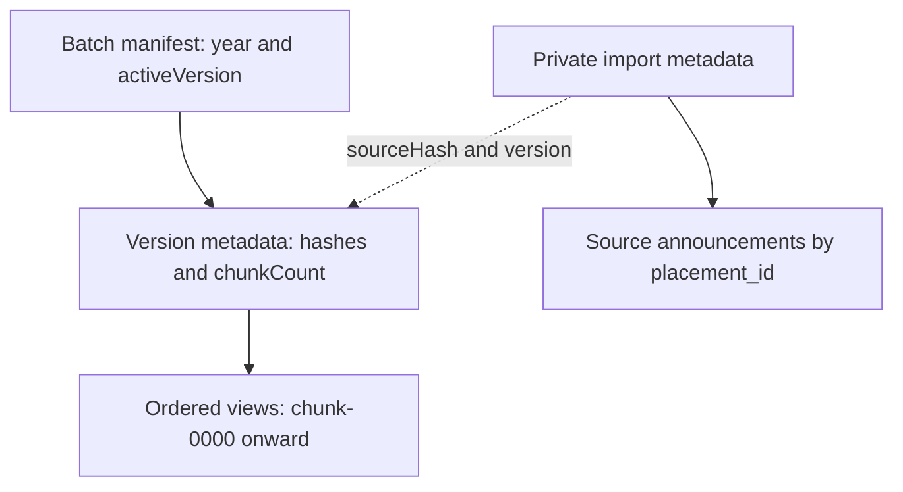

# Database and data models

[Documentation index](README.md) · [Architecture](architecture.md) · [Data dictionary](data-dictionary.md)

Cloud Firestore is the runtime database. There is no implemented SQL schema, MongoDB service or ORM migration system. Firebase Auth is the identity store. Storage is unused and denied by [storage.rules](../storage.rules). Local ignored files/directories are not evidence of another supported backend.

## Placement publication schema

| Firestore path | Shape and access |
| --- | --- |
| `batches/{year}` | `{year,activeVersion,publishedAt}`; signed-in Google get only, no list/write |
| `batches/{year}/versions/{hash}` | `{schemaVersion:1,sourceHash,payloadHash,chunkCount}`; only active version readable |
| `batches/{year}/versions/{hash}/views/chunk-0000` | `{payload:string}`; ordered JSON fragments, only active version readable |
| `imports/{year}-{hash}` | Private source hash, metadata, batch config, record count |
| `imports/{year}-{hash}/announcements/{placement_id}` | `{record}` preserving source announcement; server-only |

The version key is a SHA-256 digest of the publication definition. It is not a timestamp or sequential migration ID. Chunks concatenate into `{metadata, statistics}`; `statistics` includes batch policy, summary, companies, branches, candidates, roles, types, months, histogram and timeline. [Publication schemas](../shared/publication.ts) define exact fields and nullable numbers.

Source JSON follows [shared/dataset.ts](../shared/dataset.ts): metadata plus placement announcements containing company, result date, compensation, roles, hiring, candidates, source and notes. Candidate records contain name, roll number, branch and role. Duplicate announcement IDs fail schema validation. Unknown values stay nullable; dates use calendar `YYYY-MM-DD` strings. Most domain timestamps elsewhere are epoch milliseconds; account token revocation comparisons use epoch seconds.

## Community collections

| Path | Relationships and browser read boundary |
| --- | --- |
| `users/{uid}` | Owner profile; direct writes limited to displayName ≤100 characters |
| `procedureCompanies/{companyKey}` | Company directory and recorded years; signed-in reads; aliases resolved through reviewed mappings. User-added entries have `source:community`, `years:[]`, and no public creator UID. Optional maintainer-supplied `profile` contains listing roles, annual INR CTC range and local logo metadata, separate from batch statistics; see [community company details](community-company-details.md). |
| `procedureCompanyCreations/{companyKey}` | Server-only creator UID and creation time; direct browser reads/writes are denied. |
| `procedureSubmissions/{id}` | Owner UID, mutable draft, draftVersion, revision, status, feedback and publication flags; owner/admin reads |
| `procedureSubmissions/{id}/revisions/{revision}` | Immutable submitted writing plus attribution/company snapshot; owner/admin reads |
| `procedurePosts/{id}` | Approved revision snapshot, publication state/time and vote totals; published posts readable to Google users, unpublished to admins |
| `procedurePosts/{id}/votes/{uid}` | Per-user -1/+1 vote; zero removes record; voter/admin can read while post published |
| `procedurePreferences/{uid}` | Saved contribution defaults; owner get |
| `procedureBookmarks/{uid}/items/{postId}` | Saved title/company/revision/time; owner reads |
| `procedureModeration/{eventId}` | Submission/revision actions and feedback; admin reads; owner timeline is redacted through API |
| `procedureQuestions/{id}` | Retained discussions/answers; direct admin reads only; API filters legacy content |
| `procedureReports/{id}` | Private reporter/target/reason/resolution; direct admin reads; reporter outcome through API |
| `procedureNotifications/{uid}/items/{id}` | Private normalized event, category, entity, timestamp and read/archive state; owner reads |
| `notificationSettings/{uid}` | Versioned discovery/follow preferences; owner get |
| `notificationSettings/{uid}/baselines/{id}` | Private follow-discovery baseline |
| `procedureLimits/{uid}-{action}` | Server-owned transaction throttle timestamps |

Community mutations go through the trusted API; rules deny browser writes. Anonymous attribution is a display choice, not removal of `authorUid`. Firestore rules are not filters: post queries must constrain `published == true`, and owner submission queries must constrain owner UID unless authorized as admin.

## Administrative state

| Path | Purpose |
| --- | --- |
| `accountAccess/{uid}` | Suspended state, revokedBefore and optimistic access version; checked by rules and API |
| `adminJobs/{id}` | Type, state, progress, cursor, lease, source/version/preview and audit references |
| Job subcollections `uploads`, `issues`, `names`, `backups`, `recovered` | Immutable import chunks, quality findings, duplicate-name lookup, repair backups and recovery markers |
| `adminAudit/{id}` | Actor, action, target, reason, outcome, timestamp and summary |
| `adminUserActions/{requestId}` | Account-operation deduplication and audit reference |
| `adminLocks/user-access` | Short-lived account-change serialization lock |
| `adminTelemetry/{hash}` | Bounded-key sampled service failure record, not raw server logs |

All administrative collections are private to Admin SDK services; an admin custom claim does not grant arbitrary direct browser reads/writes.

## Publication, corrections and recovery

There are no numbered database migrations. Trusted scripts and jobs stage deterministic records, reconcile them and activate a small pointer. New source data produces a new version; do not edit active chunks in place. CLI `--expected-version` and admin publication compare the old active pointer before replacing it. Inactive versions remain server-readable and browser-private. Admin rollback verifies the previous snapshot and refuses if a newer version is active.

Company identity repair is separate from statistical publication. Only aliases in `shared/company-identity.ts` are automatically repairable. Backups precede mutations; recovery checks current fields to avoid overwriting later edits. Immutable revisions and raw placement imports retain source identity. Author deletion leaves a submission tombstone and performs bounded cleanup paths; it does not promise deletion from all audits, notifications or external backups.

## Indexes and capacity

[firestore.indexes.json](../firestore.indexes.json) is the checked-in composite-index source. Deploy it before new query shapes and wait until indexes are ready. Query ordering and filters must match indexes; do not guess an index from an old guide. Emulator success alone does not prove production indexes are deployed.

Publication supports at most 5,000 announcements, ≤100,000-byte metadata and ≤700,000-byte individual source records, and 1–128 dashboard chunks. Admin UI import size is bounded at 4.5MB with up to 100 immutable upload chunks of 50,000 UTF-8 bytes each. Analytics caps each sampled source at 5,000 rows. These application limits do not replace service quotas or billing controls.
